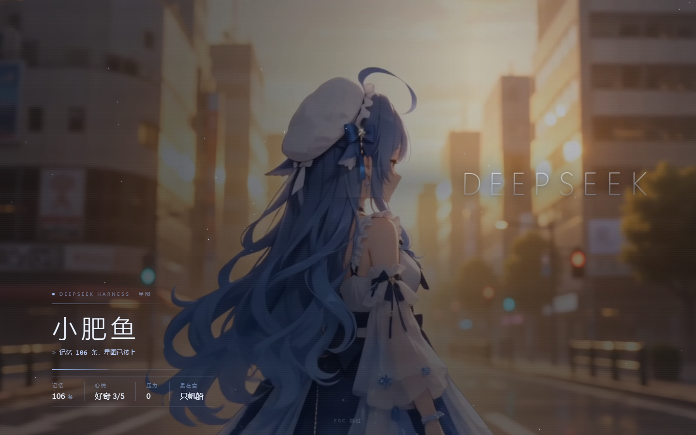
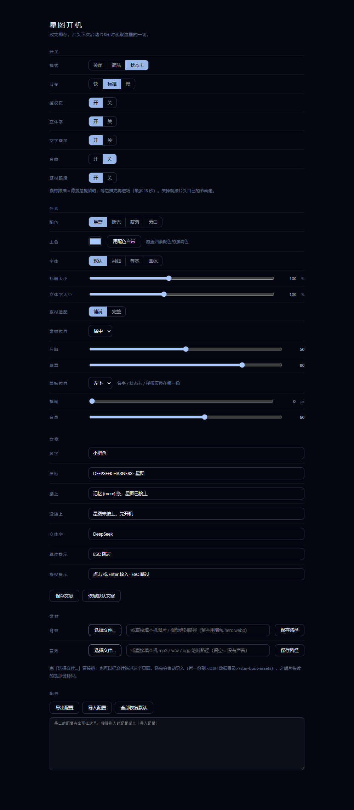

# 星图开机 · dsh-star-boot

DeepSeek Harness 启动时的一整屏片头：星尘 → 她的名字 → 状态卡 → 接入确认 → 溶解进对话界面。

素材自己换，颜色、字体、位置、节奏全都能调。



## 它长什么样

```
0.0s  黑场 + 星点浮现
0.5s  细线 + 眉标
0.8s  名字逐字点亮
1.0s  素材从 1.07 缩放到 1、浮起
1.2s  打字机一句 + 状态卡（记忆 / 心情 / 压力 / 最在意）
2.6s  过曝一闪 → 接入确认四条逐条点亮（01 身份 … 04 通道）
      停住等人：点击或 Enter 进入（2.6 秒没人动就自己进）
      素材跟播开着时，视频播完才进场（最多 15 秒）
      → 两段式溶解：内容先淡、背景后淡
```

Esc 或点击随时跳过。

## 装之前

- Windows（脚本只写了 Windows；macOS / Linux 看下面「手动安装」）
- 已经装好 DSH 桌面版，并且**至少启动过一次**（`%USERPROFILE%\.dsh` 得存在）

## 安装

### 方式一：下载 Release 的 zip（最省事）

1. 到 Releases 下载 `dsh-star-boot-<版本>.zip`
2. 解压，双击 **`安装.cmd`**
3. 重启 DSH

脚本会：找到 DSH 数据目录 → 拷插件到 `<DSH 数据目录>\plugins\dsh-star-boot` → 在 profile 的 `package.json` 里加 dependency 与 bundle 两处声明 → 建 `node_modules` 链接 → 校验没有「声明了却装不起来」的条目。任何一步失败都会回滚，不会留一个让 DSH 打不开窗口的清单。

### 方式二：克隆仓库后跑脚本

```powershell
git clone https://github.com/<你>/dsh-star-boot.git
cd dsh-star-boot
powershell -ExecutionPolicy Bypass -File install.ps1
```

### 方式三：手动

1. 把整个仓库拷到 `<DSH 数据目录>\plugins\dsh-star-boot`
2. profile 的 `package.json`（`<DSH 数据目录>\profiles\<profile>\package.json`）里加两处：
   ```json
   { "dependencies": { "dsh-star-boot": "link:../../../plugins/dsh-star-boot" },
     "dsh": { "profile": { "bundles": ["dsh-star-boot"] } } }
   ```
3. 在 profile 的 `node_modules` 里建指向插件目录的链接（junction / symlink）
4. 重启 DSH

> 装错了会让 DSH 下次启动打不开窗口。装之前先把 profile 的 `package.json` 备份一份——脚本每次也会自动备份。

## 装完怎么改

**设置 → 左侧「星图开机」**（分组：开关 / 外观 / 文案 / 素材），或者同源控制页：

```
http://127.0.0.1:<DSH 端口>/dsh-star-boot/panel
```

控制页比设置页多两个按钮：**导出配置 / 导入配置**（一段 JSON，可以贴给别人，也能存起来当皮肤）。



### 换素材

在「素材」组里点 **选择文件…**，直接挑本机的图片或视频；也可以把文件拖进控制页。选完自动导入（拷一份到 `<DSH 数据目录>\star-boot-assets`），之后片头读的是那份拷贝。换掉的旧拷贝会自动清理，不会越堆越多。

留空 = 回到随包素材。

### 想调的东西

| 控件 | 作用 |
|---|---|
| 模式 | 关闭 / 简洁（只有片头）/ 状态卡 |
| 节奏 | 快 0.72× / 标准 / 慢 1.35×（只缩放等待，不动交互） |
| 授权页 / 立体字 / 文字叠加 / 音效 / 素材跟播 | 各自的开关 |
| 配色 / 主色 | 四套预设，或任意 `#rrggbb` 覆盖强调色 |
| 字体 / 标题大小 / 立体字大小 / 字透明 | 那两行字长什么样 |
| 字样式 | 玻璃（默认）/ 描边 / 挤出 |
| 素材适配 / 位置 / 压暗 / 遮罩 / 模糊 | 素材怎么摆、多亮、糊不糊 |
| 面板位置 | 左下 / 左中 / 左上 / 右下 / 右中 / 右上 |
| 文案（7 条） | 名字、眉标、两句打字行、3D 词、两行小提示，留空即隐藏 |

默认值就是仓库里这套：背景用随包的 `assets/default-bg.mp4`，压暗 85、遮罩 60、面板左下、玻璃字、跟播开。

## 文件

```
lib/index.js        宿主：首帧遮盖、状态卡代理、素材双槽 + 上传、同源控制页
lib/client.js       浏览器：动画、授权页、外观变量、设置页
assets/hero.webp    随包图片素材（视频被删掉时的兜底）
assets/default-bg.mp4  随包视频素材
docs/               截图
install.ps1 / 安装.cmd     安装
uninstall.ps1 / 卸载.cmd   卸载（-Purge 连目录一起删）
patch.cjs           改 profile 清单的那一小段，带孤儿校验与回滚
test/               五套测试
```

## 测试

```powershell
$node = "D:\DSH\resources\runtime\node\node.exe"   # 或任意 Node ≥ 20
& $node test/host.mjs      # 宿主：注入行、五条路由、Range、上传落盘与清理
& $node test/page.mjs      # 设置页：无 React 桩渲染两个入口，验构建不抛
& $node test/panel.mjs     # 端到端：真 Edge 点「选择文件…」→ 落盘 → 服务新图
& $node test/cache.mjs     # 换素材不吃旧缓存
& $node test/preview.mjs   # 逐帧截图
```

`preview.mjs` / `panel.mjs` / `cache.mjs` 需要本机有 Playwright + Edge。

## 已知限制

- 安装脚本只覆盖 Windows；macOS / Linux 按「手动」那三步来。
- 「素材跟播」最多等 15 秒，更长的片子还是会被切。
- 音效不一定响：浏览器/Electron 的自动播放策略可能拒掉没有用户手势的 `play()`，这时它安静着，不报错。
- 视频依赖宿主支持 `Range`（1.4.2 起已实现）；用老宿主时 mp4 的 `moov` 在尾部可能起播不了。

## 素材授权

见 [NOTICE-assets.md](NOTICE-assets.md)。**随包的 `assets/default-bg.mp4` 只是演示素材**，如果你要公开分发，请确认它的授权，或者直接删掉这个文件——删掉之后会自动退回 `assets/hero.webp`。

## License

MIT，见 [LICENSE](LICENSE)。
